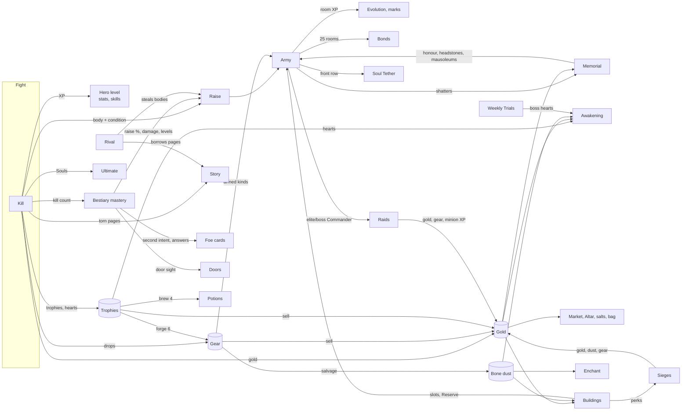

# 3. How the systems connect

This page maps what feeds what, so new work connects systems instead of adding islands. The numbered gaps at the end
(G1, G2, ...) are referenced by the roadmap: a round lists the gaps it closes, and when it ships, the gap is struck
through here with the PR number.

## 3.1 Resource flows

## 3.2 System by system

| System | Takes from | Gives to | Notes |
|---|---|---|---|
| Combat | Hero stats, skills, army, gear, statuses, omens, curses, difficulty | Kills, Souls, corpse conditions, records, tallies | Everything ends here; most time is spent here |
| Raising | Bodies, mana, Will, salts, Ossuary, bestiary, corpse condition, omen | The army, titles, tallies | One soul per boss limits boss stacking |
| Army (traits, evolution, marks, fusion, bonds) | Raises, room XP, Bone Altar gold, fusion gold | Combat power, tether, raids, siege wall, titles | The deepest web in the game |
| Bestiary mastery | Kill counts | Raise chance, damage, raise levels, foe-card info, door sight, titles | Kept through NG+ |
| Gear and uniques | Drops, market, forge, raids, sieges, bounties, rival | Hero and gear-bearer stats, unique flags, sets | Rolls, reforge, enchant, temper |
| Awakening | Gold, dust, boss hearts (kills, Trials) | Unique stats | Hearts tie bosses and Trials to the endgame |
| Trophies | Kills | Gold, forged gear, potions, hearts | Tower trophies only sell (G11) |
| Town buildings | Gold, dust | Slots, Reserve, raise %, mana, discounts, siege perks | Finished by mid-game (G12) |
| Bounties | Tallies of any activity | Gold, salts, dust, gear | Good glue: reads many systems |
| Raids | Commander minions, squad strength | Gold, gear, minion XP, Memorial | A dice roll (G17) |
| Sieges | Town levels, calendar, Reserve wall, guard choice | Gold, dust, gear, building damage | Fixed roster (G23) |
| Rival | Calendar, your army's main role, your bodies | Legendary, gold, page loss or fine, story | No arc or end (G19) |
| Trials | Throne clear, curses, tiers, seed | Gold, dust, hearts, records | Good: pays the Awakening economy |
| Faith | Level, calendar | Static buffs, blessing, faith events, story | Binary and static (G18) |
| Omens | Calendar | Rule changes for a day, titles | Not forecast or caused (G20) |
| Curses | Calendar, cleared gates | Harder runs, more reward, titles, bounty | Five curses only (G24) |
| Hell Tower | Level 10, 3 clears | 12 uniques, titles, story, abyss gold | Wardens reuse gate moves (G3) |
| Rift | Level 40, Throne | Legendaries, records, titles, story | No unique rewards (G22) |
| Titles | Tallies, records, everything | One worn bonus, collection gold | 148 titles, small effect (G26) |
| Memorial | Shattered and raid-fallen minions | Honour buff, headstones, mausoleums | Strong emotional link |
| Story and pages | Clears, milestones, page drops | Lore, rival stakes | Missing ending (G16) |
| NG+ | Throne clear | A new cycle with carried knowledge | Same content (G21) |

## 3.3 Strong links to keep

These are the connections that make the game feel like one thing. Don't break them; build more like them.

- **How it died decides what it becomes**: kill method -> corpse condition -> raise chance and death trait.
- **Knowledge is sight**: kill counts -> mastery -> foe intents, damage figures, answers, door previews, raise bonuses.
- **Your dead are your armor**: front row -> Soul Tether; Constitution -> minion HP; Guard; Taunt.
- **Theft and reclaim**: the rival steals your best body -> fields it against you -> you kill it and get the body back.
- **Loss becomes a monument**: shatter -> Memorial -> honour, headstones, mausoleums -> army strength.
- **Bosses keep paying**: boss hearts from kills and Trials -> Awakening of that boss's unique.
- **Nightfall ties the day together**: raids march, sieges come, the Reserve guards the wall, dawn brings them home.
- **Bounties read everything**: kills, elites, raises, arches, orders, floors, poisonings, the cursed gate.

## 3.4 Weak or missing links (the gap list)

Each gap names the systems involved and why it matters. The roadmap's rounds reference these numbers.

**Combat depth**

- ~~**G1. Foe kinds have no identity.**~~ Closed by R1 PR B: sixteen foe kits, one per kind, shown on the card by mastery
  tier, listed in door lore and the Codex; weakness kills raise the Undone with an echo of the kit. (Was: The 42 gate foes share their role's stat factors; only the Whisper Choir does
  something of its own. Learning a foe in the bestiary reveals numbers, not behavior, so "read the fight" has little to
  read in ordinary rooms. (Combat, bestiary, doors, corpse conditions.))
- ~~**G2. Strong players alpha-strike.**~~ Closed in part by R1 PR B: kits give rooms at your level something to read
  (shields, marks, burrows, banners, bombers) and the bot now targets by kit; outgrown rooms are swept instead of
  clicked. Boss fights stay for R2. (Was: The bots end most rooms in one action once ahead; turn-based Trial scores floor
  near 4; orders, statuses and combos rarely matter in content you have outgrown. Stacked foe multipliers above ~3x HP per
  hit become walls instead of puzzles. (Combat, difficulty, Trials.))
- ~~**G3. Bosses have one move.**~~ Closed by R2: the six gate bosses, the rival and the Inquisitor Captain fight with move
  sets, twists and hazards (PR A); secret masters have their own kits and a half-HP rule, wardens a signature each (PR B). (Was: Six gate bosses, ten wardens, six secret masters and the rival share seven moves
  between them; wardens and secret masters reuse the gate moves, the rival only has Royal Decree. (Bosses, Tower, secret
  masters, rival.))
- ~~**G4. No damage types.**~~ Closed by R1 PR A: five types, place profiles, typed affixes, resistance and damage bonus lines.
  (Was: Frost, fire, rot and shadow exist as flavor (Rimeborn, Cinderborn, blight, the Eclipse's
  "shadow"), but nothing resists or is weak to them, so gear, affixes, traits and skills cannot specialize against a gate.
  (Combat, traits, gear, omens, bestiary.))
- ~~**G5. Outgrown content is slow.**~~ Closed by R1 PR B: Sweep wins an outgrown Normal gate run for one watch at 80%
  kill XP. (Was: Farming far below your level pays less but costs the same clicks; there is no quick
  resolve for rooms you cannot lose. (Combat, raids, calendar.))

**Army**

- **G6. The Reserve is only storage.** Benched minions do not grow, train or do anything; with 6-12 places it is a
  shelf. (Reserve, town, raids, evolution.)
- **G7. Most minions cannot use gear.** Only one armed kind per gate takes gear; unique flags work only for the hero.
  (Gear, army, uniques.)
- **G8. Commander only matters for raids.** A rare, exciting trait with one use. (Traits, raids, combat, sieges.)
- **G9. Hero power vs army strength.** ~~The hero alone can still carry rooms.~~ Closed by Command (PR #5): the hero's
  Strike, Siphon and HP grow from the army's three strongest minions.

**Economy and town**

- **G10. Late gold outruns every sink.** ~1.1M lifetime gold in the full bot; most sinks are capped (buildings, bag,
  salts, tempering lines, mausoleums); headstones are the only open-ended one and are softly capped at 6%. (Economy,
  town, Awakening.)
- **G11. Some loot is dead-end.** Tower trophies (40 gold, sell only), Tower and secret-master hearts beyond Awakening,
  and abyssal floors that pay generic legendaries. (Trophies, Tower, secret masters, crafting.)
- **G12. The town is small and finishes early.** Four buildings, three levels each, done by mid-game; they do not touch
  raids, faith, the bestiary or the Reserve beyond places. (Town, sieges, raids, faith, Reserve.)
- **G13. The daily quest is not a choice.** 8 kills, 4 rooms, 1 clear is always done, so it is a hidden free stat point
  per day. (Quest, calendar, bounties.)
- **G14. Consumables are thin.** Two potions and salts, belts of three; no consumable that changes how a fight goes.
  (Market, trophies, brewing, combat.)
- **G15. The town's fear has no memory.** The story says the town fears you and sieges punish you, but prices, events and
  siege strength never react to what you do. (Sieges, market, faith, story.)

**Content and modes**

- **G16. The story has no ending.** (Part closed by R3 PR A: act VI and Vane Abbey lead to the Hunger; the choice itself
  comes with PR B.) Five acts and twenty pages build to "write your name and close the book, or keep
  writing", and the game does not let the player choose. Tower floor 100 makes the book "whole" with no consequence.
  (Story, pages, Tower, secret masters, NG+.)
- **G17. Raids are one dice roll.** Normal, cleared gates only; they never touch difficulty, curses, hearts, bounties,
  the Tower or the Rift, and offer no choices. (Raids, Commander, economy.)
- **G18. Faith is a binary with a static buff.** Two oaths, devotion is only time; the Old Gods never touch omens,
  curses, sieges (the Inquisition) or the story past two passages. (Faith, omens, sieges, events, story.)
- **G19. The rival has no arc.** Same move, same loop, no territory, no ending; New Game+ resets their strength.
  (Rival, story, NG+, raids.)
- **G20. Omens are weather, not choices.** Nothing forecasts, calls or wards off an omen, and the town never reacts to
  one. (Omens, faith, town, calendar.)
- **G21. New Game+ is the same content harder.** Pacts are multipliers; there is no new content, foe or story per
  cycle beyond three passages. (NG+, story, content.)
- **G22. The Rift only scales.** Endless stat growth and generic legendaries; no modifiers to choose, no Rift-only
  rewards, no link to Trials, omens or the rival. (Rift, gear, records.)
- **G23. Sieges never change.** One roster, three waves, the same Captain; the Inquisition has no story that escalates
  with your wins and losses. (Sieges, story, town.)
- **G24. Curses and events repeat.** Five curses for the whole game; six events and three chains (the full bot meets ~264
  events in 100 days). (Curses, events, Trials.)

**Hero and meta**

- **G25. Hero builds are narrow.** No stat respec; seven actives; Frost and Rot paths have four skills to Bone and
  Blood's five; three ultimates. (Skills, paths, stats.)
- **G26. Titles are mostly a list.** 148 titles but only the worn one does anything, and its bonus is small; collection
  pays only gold. (Titles, meta.)
- **G27. Balance is measured only by bots.** No record of how a human plays (deaths, time per run, what they ignore)
  that a playtester could send back. (Tooling.)

**Missing systems** (found 2026-11-26 when the roadmap was deepened; each is a whole system the game lacks, not a weak
link between existing ones)

- **G28. The valley is a list, not a place.** Gates, Tower, Rift and town are cards; the lore's river, roads, villages
  and chapel are never somewhere the player stands. Watches have no geography. (Map, travel, story.) R19.
- **G29. The living are faceless.** They exist only as siege waves; there is no one to trade with, help or prey on, so
  dread and raising have no moral or economic face. (Villages, dread, raising.) R20.
- **G30. Power has no personal cost.** The hero's body and kit never change with what they do; the Ledger's corruption
  of its keeper is only lore. (Hero, faith, story.) R21.
- **G31. Minions can be shaped but never designed.** Every minion is a foe that rose; spare bodies and trophies have no
  creative use. (Army, crafting, trophies.) R22.
- **G32. A fallen minion's line ends.** The Memorial remembers names, but nothing of what a minion was carries into the
  next raise of its kind; raising is only a dice roll, never a slow craft. (Memorial, raising, Embalmery.) R23.
- **G33. The keeper does everything personally.** No one but the hero (and a raid squad) works; no succession for the
  book. (Late game, endings, town.) R24.
- **G34. The year is flat.** 100 days with no seasons; omens are the only daily variation and are unconnected to time.
  (Calendar, omens, garden, map.) R25.
- **G35. A failed raise is a dead end.** The body is gone; Souls exist only inside a run. (Raising, Souls, gear.) R26.
- **G36. Minions are never tested on their own.** The Reserve and the army's builds have no stage of their own. (Army,
  Reserve, commands.) R27.
- **G37. The hero's deaths are pure loss.** A counter remembers them; nothing else does. (Defeat, hero, story.) R28.
- **G38. The player never defends a dungeon.** Sieges are fixed battles at the walls; the town's treasure is never at
  risk in a way the player designs against. (Town, Reserve, economy.) R29.
- **G39. No long project that ties systems.** Progress is split across a dozen places; nothing lets the player pay one
  system's resource to improve another's rules. (Meta, Library, every system.) R30.
