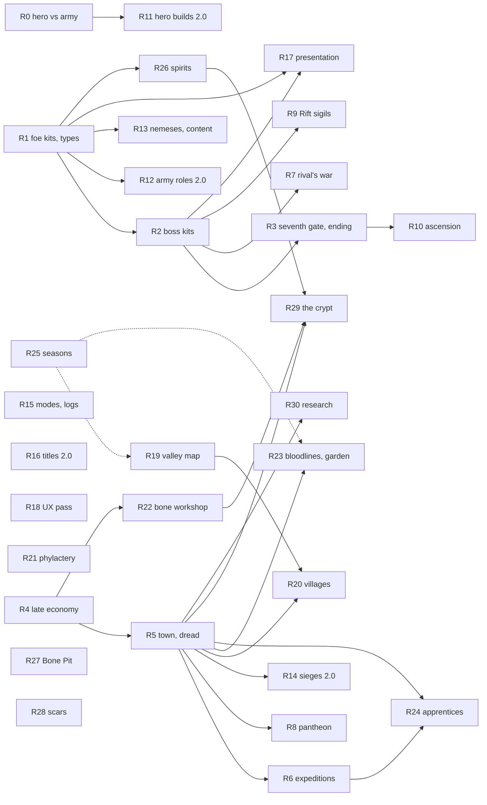

# 5. Roadmap

Everything worth adding, improving or connecting, grouped into big rounds and ordered by priority. Each round is a
substantial feature or rework; small fixes ride along inside one. Rounds name the gaps they close (G-numbers from
[03-connections.md](03-connections.md)) and the balance problems they address (B-numbers from
[04-balance.md](04-balance.md)).

**How to read a round**

- **Goal**: the one-sentence promise to the player.
- **Closes**: gaps and balance problems.
- **Scope**: what gets built. Names are working names.
- **Connects**: the systems it ties together.
- **Done when**: the measurable bar, mostly bot numbers.
- **Needs**: rounds that should ship first. **Size**: L (one PR, a few days) or XL (may split into two PRs).

**Priority order at a glance**

| # | Round | Priority | Closes | Needs | Size | Spec |
|---|---|---|---|---|---|---|
| R0 | Hero power scales with army strength | Shipped (#5) | G9, B8 | | L | |
| R1 | Every foe is a puzzle: foe kits and damage types | Shipped (#9, #10) | G1, G2, G4, G5, B1, B2, B5 | | XL | [spec](rounds/R01-foe-kits-and-damage-types.md) |
| R2 | Masters worth remembering: boss kits | Shipped (#11, #12) | G3, G11 (part) | R1 | XL | [spec](rounds/R02-boss-kits.md) |
| R3 | The end of the book: the seventh gate and the ending | Shipped (#13, #14) | G16, G21 (part) | R2 helps | XL | [spec](rounds/R03-the-end-of-the-book.md) |
| R4 | Gold that means something: late economy and crafting | Shipped (#15, #16) | G10, G11, G14, B3 | | L | [spec](rounds/R04-late-economy-and-crafting.md) |
| R5 | The necropolis grows: town expansion and the town's dread | Shipped (#17, #18) | G6, G12, G13, G15, B7 | R4 helps | XL | [spec](rounds/R05-the-necropolis-grows.md) |
| R6 | Expeditions: raids rework and Commanders in battle | Shipped (#19) | G17, G8 | R5 | L | [spec](rounds/R06-expeditions.md) |
| R7 | The rival's war: an arc with an ending | Shipped (#20, #21) | G19 | R2 | L | [spec](rounds/R07-the-rivals-war.md) |
| R8 | The pantheon: faith rework, gods and omens | Shipped (#22, #23) | G18, G20 | R5 | L | [spec](rounds/R08-the-pantheon.md) |
| R9 | Rift sigils and Riftborn gear | Shipped (#24, #25) | G22, B4 | R2 | L | [spec](rounds/R09-rift-sigils.md) |
| R10 | Ascension: New Game+ rework | Shipped (#26, PR B) | G21 | R3 | L | [spec](rounds/R10-ascension.md) |
| R11 | Hero builds 2.0 | Shipped (PR A #28, PR B this PR) | G25, B2 | | L | [spec](rounds/R11-hero-builds.md) |
| R12 | Army roles 2.0: charms, minion actives, a fifth role | Shipped (PR A #30, PR B) | G7, G8 | R1 | XL | [spec](rounds/R12-army-roles.md) |
| R13 | Nemeses and a living valley: content pack | Shipped (PR A #32, PR B #33) | G24, G20 | R1 | L | [spec](rounds/R13-nemeses-and-content.md) |
| R14 | Sieges 2.0: the Inquisition escalates | Shipped (PR A #34, PR B #35) | G23 | R5 | L | [spec](rounds/R14-sieges-2.md) |
| R15 | Modes and playtest logs | Shipped (PR A #36, PR B #37) | G27, B6 | | L | [spec](rounds/R15-modes-and-logs.md) |
| R16 | Titles and collection 2.0 | Shipped (#38, PR B) | G26 | | L | [spec](rounds/R16-titles-and-collection.md) |
| R17 | Presentation: music, stage, art | Shipped (#40, PR B) | | R1, R2 | L | [spec](rounds/R17-presentation.md) |
| R18 | UX and onboarding pass | Shipped (#42, PR B) | | after any 3 rounds | L | [spec](rounds/R18-ux-and-onboarding.md) |
| R19 | The valley map: roads, sites and travel | Shipped (#44, PR B) | G28 | | XL | [spec](rounds/R19-the-valley-map.md) |
| R20 | Villages of the living: trade, tribute and fear | Shipped (#46, PR B) | G29 | R5 | L | [spec](rounds/R20-villages-of-the-living.md) |
| R21 | The phylactery: corruption and the hero's transformation | P4 | G30 | | L | [spec](rounds/R21-the-phylactery.md) |
| R22 | The bone workshop: constructs built from parts | P4 | G31 | R4 helps | L | [spec](rounds/R22-the-bone-workshop.md) |
| R23 | Bloodlines and the grave garden | P4 | G32 | R5 | L | [spec](rounds/R23-bloodlines-and-the-grave-garden.md) |
| R24 | Apprentices: a school of the Ledger | P4 | G33 | R5 | L | [spec](rounds/R24-apprentices.md) |
| R25 | Seasons and weather | P4 | G34 | | L | [spec](rounds/R25-seasons-and-weather.md) |
| R26 | Spirits and soulbinding | P4 | G35 | R1 | L | [spec](rounds/R26-spirits-and-soulbinding.md) |
| R27 | The Bone Pit: minion duels and tournaments | P4 | G36 | | L | [spec](rounds/R27-the-bone-pit.md) |
| R28 | Scars: what death leaves on the hero | P4 | G37 | | L | [spec](rounds/R28-scars.md) |
| R29 | The crypt beneath: tomb robbers and a dungeon to defend | P4 | G38 | R5 | XL | [spec](rounds/R29-the-crypt-beneath.md) |
| R30 | Necromantic research: a tree that ties everything | P4 | G39 | R5 | L | [spec](rounds/R30-necromantic-research.md) |

The order is a recommendation, not a queue: pick the highest round whose needs are met, unless a later one fixes
something that hurts more right now.

## Phases

The rounds fall into five phases. Phase 5 rounds are new systems; they can be picked earlier when their needs are met
and one fits what the game needs most at the time. A phase is done when its rounds have shipped and 04-balance.md shows its numbers.

| Phase | Rounds | The game after it |
|---|---|---|
| **1. Fights worth reading** | R0, R1, R2 | every foe and boss has a kit and a damage type; rooms last a few actions; bosses are remembered |
| **2. A game with an end** | R3, R4, R5 | the book ends with a choice; late gold, trophies and hearts all buy something; the town grows all game and fears you |
| **3. Systems that talk** | R6-R12 | raids, the rival, faith, the Rift, NG+, hero builds and army roles each tie into three or more other systems |
| **4. A finished game** | R13-R18 | content depth, modes, collection, music and art, and a UX pass over everything |
| **5. New systems** | R19-R30 | the valley becomes a place with villages, seasons and a crypt to defend; the hero can be corrupted and scarred; minions can be designed, bred, trained in a pit and succeeded by apprentices; a research tree ties it all |

## Dependencies

Solid arrows are hard needs (the later round uses code the earlier one adds); dotted arrows are hooks that make the
later round richer. R3 can ship before R2 with the fallback
moves in its spec; R5 can ship before R4 with its Apothecary limited to potions.

## Which systems each round touches

A round that touches many systems is a connecting round; the matrix shows where the game's links will come from.
**●** builds the system, **○** connects to it.

| System | R1 | R2 | R3 | R4 | R5 | R6 | R7 | R8 | R9 | R10 | R11 | R12 | R13 | R14 |
|---|---|---|---|---|---|---|---|---|---|---|---|---|---|---|
| Combat | ● | ● | ○ | ○ | | ○ | | ○ | ○ | ○ | ● | ● | ○ | ○ |
| Foes and bestiary | ● | ○ | ● | | ○ | ○ | | | ○ | ○ | | ○ | ● | ● |
| Bosses | ○ | ● | ● | ○ | | | ○ | ○ | ● | ○ | | | | ● |
| Army and traits | ○ | | ○ | | ● | ○ | ○ | ○ | ○ | ○ | | ● | ○ | |
| Gear and crafting | ○ | ○ | ○ | ● | ○ | | ○ | | ● | ○ | ○ | ● | | |
| Economy | | | | ● | ● | ○ | | | | | | | | ○ |
| Town and Reserve | | | | ○ | ● | ○ | | ○ | | ○ | ○ | | ○ | ● |
| Sieges | ○ | ○ | | | ● | ○ | ● | ○ | | | | | | ● |
| Raids | ○ | | | ○ | ○ | ● | ○ | | | | | | | |
| Faith and omens | ○ | | ○ | | ○ | | | ● | | | | | ● | ○ |
| Story and endings | | ○ | ● | | | | ● | ○ | ○ | ● | | | ● | ● |
| Tower, Rift, Trials | ○ | ● | ○ | ● | | ○ | | | ● | | ○ | | | |
| Rival | | ● | ○ | | ○ | ○ | ● | | | ○ | | | ○ | |
| Memorial | ○ | | ● | | | | | ○ | | | | ● | ○ | |
| NG+ | | | ● | | | | ○ | | | ● | | | | |

**Phase 5 rounds** (new systems):

| System | R19 | R20 | R21 | R22 | R23 | R24 | R25 | R26 | R27 | R28 | R29 | R30 |
|---|---|---|---|---|---|---|---|---|---|---|---|---|
| Combat | ○ | | ● | | | | ○ | ○ | ● | ○ | ● | ○ |
| Army and traits | | ○ | ○ | ● | ● | ○ | | ○ | ● | | ○ | ○ |
| Hero | | | ● | | | | | | | ● | | ○ |
| Raising and corpses | ○ | ○ | ○ | ○ | ● | | ○ | ● | | | ○ | ○ |
| Gear and crafting | | ○ | | ● | | | | ● | ○ | | ○ | |
| Economy | ○ | ● | | ○ | | ○ | | | ○ | | ● | ○ |
| Town and Reserve | | ○ | ○ | ● | ● | ● | | ○ | ● | ○ | ● | ● |
| Sieges | ○ | ○ | ○ | ○ | | ○ | ○ | | | ○ | ○ | ○ |
| Faith and omens | ○ | ○ | ○ | | ○ | ○ | ● | ○ | | ○ | | ○ |
| Story and endings | ● | ● | ● | | | ● | ○ | | | ○ | | |
| Map and travel | ● | ○ | | | | | ○ | | | | | ○ |
| Memorial | | | | ○ | ● | ○ | | | | | | |
| Rival | ○ | | | | | ○ | | | ○ | | ○ | |

## Every idea

[06-idea-catalogue.md](06-idea-catalogue.md) lists every add, improve and connect idea per system with an ID and its
round. Ideas marked **free** are not in a round yet; pick them up as ride-alongs.

---

---

## P1: the next five rounds

### R1. Every foe is a puzzle: foe kits and damage types
**Full spec**: [R01-foe-kits-and-damage-types.md](rounds/R01-foe-kits-and-damage-types.md).
**Goal**: every kind of foe fights in its own way, so reading a room and choosing answers matters in every fight, not
just boss rooms.
**Closes**: G1, G2, G4, G5; B1, B2, B5.

**Scope**
- **Damage types**: physical, frost, fire, rot and shadow. Every source gets one: Strike and Bone Spear physical; Soul
  Siphon, Reap and blight shadow; Grave Chill frost; Corpse Explosion and poison rot; Cinder Wave and burns fire. Minion
  hits take their trait's type (Rimeborn frost, Cinderborn fire, Venomous and Necrotic rot), else physical.
- **Resistances and weaknesses per gate and per kind**, small and readable (weak +25%, resist -25%, immune only on a few
  bosses): the Ashen Barrow resists fire and is weak to frost, the Sunken Crypt's drowned dead are weak to fire, the
  Hollow Cathedral's choir resists shadow, the Iron Orchard's iron is weak to rot, and so on.
- **Foe kits**: each of the 42 gate foes and 8 Tower foes gets one behavior from a pool of about 16, shown on its card:
  shield-bearer (guards the weakest ally), ambusher (opens on your back row), mana thief, grave-caller (raises a fallen
  foe once), pack hunter (stronger per living kin), bomber (bursts on death), sapper (breaks your ward), skirmisher
  (steps to the back row when hurt), bulwark stance (armor up every other turn), hexer, marker (marks a minion for
  focus fire), mender-priest (cleanses foes), burrower (untargetable for a turn), reflector, frenzy (faster when allies
  fall), banner-bearer (buffs the room while alive). Two foes of the same role in one gate never share a kit.
- **Bestiary**: Studied shows the kit's name, Known its rules and the kind's weakness, Mastered the numbers, Ledgered the
  best answer. Doors show kits as far as door sight reaches.
- **Corpse conditions**: a foe killed by its weakness rises "Undone" (a new death trait that inherits a weaker copy of
  its kit), linking kits to the army.
- **Gear and affixes**: resistance and "+% type damage" bonus lines; elite affixes gain typed variants (Frost-touched,
  Burning).
- **Sweep** (G5): on Normal, a cleared gate whose rooms the hero's modeled strength far outclasses can be swept: the run
  resolves at once with its full loot and reduced XP (the farming falloff already applies), so outgrown farming costs one
  click, not twenty.
- Teach the bot to answer kits (focus shield-bearers, ward before sappers, kill bombers away from the front row).

**Connects**: combat, bestiary, doors, corpse conditions, traits, gear lines, affixes, omens (Eclipse already boosts
shadow; Iron Rain and Soul Storm get type hooks), Trials.
**Done when**: at the Recommended level a gate room lasts 2-4 player actions for the `market` bot (it is ~1 now when
ahead); gate clears back near 85% (retune `DIFF` down where kits add danger); stat builds within 4 points on gates and
Constitution within 5 floors in the Tower; Sweep used on outgrown gates by the bot with no change to gate rates.
**Size**: XL (damage types and resistances, then kits).

### R2. Masters worth remembering: boss kits
**Full spec**: [R02-boss-kits.md](rounds/R02-boss-kits.md).
**Goal**: every boss, warden and secret master is a fight with its own moves, phases and answers.
**Closes**: G3, part of G11.

**Scope**
- **Gate bosses**: three moves each (the signature plus two), and a phase two of their own instead of the shared
  Sundering Blow. Examples: the Rat King's court grows a rat for each Swarm left alive; the Crypt Warden locks a minion
  behind the Bone Wall; the Ember Knight's burning ground punishes the front row; the Bishop of Teeth turns your Silence
  into a choir that heals; the Orchard Mother's seedlings mature into vanguards; the Pale Sovereign's Decree names one of
  your minions and executes it unless guarded.
- **Secret masters** with their own kits: the Plague Matriarch's brood, the Drowned Abbot's rising tide (a turn counter),
  the Cinder Wyrm's breath line, the Choir Eternal's verses, the Rootking's regrowth, the Nameless Sovereign copying your
  last skill.
- **Tower wardens**: ten signature moves of their own (the Gate Hound's three heads act as three intents, the Duke of
  Chains chains a minion, the Pale Executioner marks a target for execution, the Hollow Seraph's halo reflects...).
- **Boss damage types and resistances** from R1; arena hazards shown on the boss card.
- **The rival** fights with moves drawn from the roles of the bodies they stole, so their thefts change the duel.
- **Hearts**: each boss's heart gets a second use beyond Awakening (a heart-forged item line, see R4).
- Bestiary Ledgered shows the whole kit and its answers; defeat recaps name kit moves.

**Connects**: combat, bestiary, rival, Tower, secret masters, Awakening, crafting, presentation (arenas).
**Done when**: each boss fight averages 4-7 turns at the Recommended level; boss room clears stay at the gate's target;
the Tower curve and rival win rate stay in their target bands.
**Needs**: R1 (damage types). **Size**: XL (gate bosses and rival, then wardens and secret masters).

### R3. The end of the book: the seventh gate and the ending
**Full spec**: [R03-the-end-of-the-book.md](rounds/R03-the-end-of-the-book.md).
**Goal**: the story the Ledger has been telling ends with a real choice and a final place to fight for it.
**Closes**: G16, part of G21.

**Scope**
- **Vane Abbey**, a seventh gate beneath the drowned chapel, opening once the Throne has fallen, the Tower's floor 100 is
  taken and the twentieth page is found (or all six secret masters slain, so a player has two routes). New foes (the
  plague year's dead, Oswin's brothers), its own set, unique and boss: **the Hunger**, the thing Oswin gave a shape to.
- **The choice** after the Hunger falls: **Close the book** (write your own name: an epilogue, the dead sleep, the save is
  marked Closed, and a New Game+ "The Quiet Valley" begins with gentler gates but no raising until the first clear) or
  **Keep writing** (the book stays open: a New Game+ "The Keeper's Cycle" begins, carrying one Ledger inscription, a
  permanent small perk chosen from your deeds). Both endings have their own title and passages, and the Records keep the
  day and cycle you ended on.
- **Act VI** passages for the abbey and both endings; the rival appears at the end if R7 has shipped.
- Floor 100 of the Tower and the twentieth page get mechanical weight: they are the abbey's keys.

**Connects**: story, pages, Tower, secret masters, NG+, titles, records, rival.
**Done when**: a `full` bot can reach and clear the abbey in a long game (measure the day it does), the boss sits on the
gate curve (~80% at its Recommended level), both endings start a valid New Game+ and survive save round trips.
**Needs**: R2 makes the final boss richer but is not required. **Size**: XL.

### R4. Gold that means something: late economy and crafting
**Full spec**: [R04-late-economy-and-crafting.md](rounds/R04-late-economy-and-crafting.md).
**Goal**: late gold, trophies and hearts always have something worth buying, and every kind of loot has a use.
**Closes**: G10, G11, G14; B3.

**Scope**
- **Heart-forging** (the Forge): boss and warden hearts plus gold and dust forge a legendary of your choice of slot with
  two bonus lines you pick from that boss's themed list; secret-master hearts add a third line or a minor power.
- **Tower trophies** forge Tower-tier gear; abyssal floors past 100 pay abyssal trophies for the same.
- **Consumables 2.0** (brewing from specific trophies): weapon oils (a damage type for a run), incense (raise chance for a
  run), bone charms (one-shot effects: an extra order, a free Retry, a guaranteed elite door), war banners for raids. Belt
  upgrades (three to five slots).
- **The income curve**: kill gold grows more slowly past the Throne; open-ended sinks (heart-forging, consumables,
  commissions, town upkeep from R5) take over from capped ones. Keep the measured Awakening and headstone spending.
- **Commissions**: the town posts orders for specific trophies or gear (gold and town standing, see R5).
- **Market**: a weekly black-market stall that trades dust, hearts and abyssal trophies.

**Connects**: trophies, bosses, Tower, secret masters, market, Awakening, combat (consumables), raids (banners), town.
**Done when**: `full` bot gold held at day 100 ~10-20k (from ~35k) with most lifetime gold spent; every trophy kind has
at least one use besides selling; `full` stays 1-3 points over `market`.
**Size**: L.

### R5. The necropolis grows: town expansion and the town's dread
**Full spec**: [R05-the-necropolis-grows.md](rounds/R05-the-necropolis-grows.md).
**Goal**: the town keeps growing all game, every building changes how you play, and the living react to what you do.
**Closes**: G6, G12, G13, G15; B7.

**Scope**
- **New buildings** (to about ten): the **Charnel Yard** (benched Reserve minions train and earn XP each day), the
  **Library** (faster bestiary study, research projects, stat respec), the **Embalmery** (keep one body per run to raise
  later), the **Bell Tower** (siege warning and wall defenses), the **Apothecary** (R4's consumables), the **War Room**
  (R6), the **Temple** (R8). Existing buildings go to five levels with a choice of specialization at levels 3 and 5.
- **Dread**: a town meter moved by sieges won and lost, raising near town, oaths, commissions and tithes. Low dread: better
  prices and gentler sieges; high dread: bigger sieges, harder market, but plunder and fear-driven events.
- **Daily orders** replace the fixed daily quest: pick one of three each dawn (a gate, a role to raise, a style of win),
  each paying a different reward (a stat point, dust, standing).
- **Upkeep**: higher building levels cost a little gold each dawn, a soft sink that scales with the town.
- Every building lends a siege perk (extend `SIEGE_PERK`).

**Connects**: town, Reserve, sieges, raids, faith, bestiary, economy, calendar, events.
**Done when**: the Reserve's minions grow while benched; the town has something to build through day 100; daily order
choice measurably varies between bots; sieges held stays 80-87% with dread in play.
**Needs**: R4 helps (Apothecary, upkeep). **Size**: XL (buildings and the Yard, then dread and orders).

---

## P2: rounds after that

### R6. Expeditions: raids rework and Commanders in battle
**Full spec**: [R06-expeditions.md](rounds/R06-expeditions.md).
**Goal**: sending your dead out is a plan with choices, and a Commander matters in every fight.
**Closes**: G17, G8.
**Scope**: raids become expeditions of one to three nights against any cleared gate on any cleared difficulty, a cursed
gate, a Tower floor band, a hunt for one kind (its trophies and hearts) or the rival's stash (with R7); dawn reports offer
a choice (press on, come home, take the risky path); squad roles and damage types against the target's kits change the
odds; a Commander in your army grants a free **Rally** order once per room; the War Room building (R5) adds squad size and
intel. **Connects**: raids, Commander, town, bestiary, kits, economy, rival. **Done when**: raids won stays ~75-80% with
choices; expeditions are worth about as much as a watch spent fighting; Rally changes room outcomes measurably.
**Needs**: R5 (War Room). **Size**: L.

### R7. The rival's war: an arc with an ending
**Full spec**: [R07-the-rivals-war.md](rounds/R07-the-rivals-war.md).
**Goal**: the rival becomes a story with stakes that builds to a final reckoning.
**Closes**: G19.
**Scope**: an escalating arc (thefts, challenges, a raid on your town led by the rival, then their lair, a gate of their
own built from the bodies they stole); the final duel with their whole book; outcomes that matter (beat them for good and
their ledger becomes a set of three rival uniques, or spare them and they return in New Game+ as an uneasy ally who
trades bodies); rival strength carries a share into New Game+; recover stolen bodies by raiding their stash.
**Connects**: rival, sieges, expeditions, story, NG+, uniques, bestiary. **Done when**: the arc completes in a 100-day
`full` bot game; the duel is won ~65-75%. **Needs**: R2 (rival kit). **Size**: L.

### R8. The pantheon: faith rework, gods and omens
**Full spec**: [R08-the-pantheon.md](rounds/R08-the-pantheon.md).
**Goal**: an oath is a relationship with a god that you grow through deeds, and the gods move the weather.
**Closes**: G18, G20.
**Scope**: four named Old Gods and a profane path, each tied to omens and a playstyle; devotion grows by deeds (not only
days); boons unlock in steps; an oath forecasts tomorrow's omen and lets you spend devotion to call or ward one; shrines
in gates per god; the Inquisition (sieges) and the town's dread react to your god. **Connects**: faith, omens, events,
sieges, dread, story. **Done when**: each oath is within a few points of the others on gates; omen calls are used by the
bot. **Needs**: R5 (Temple, dread). **Size**: L.

### R9. Rift sigils and Riftborn gear
**Full spec**: [R09-rift-sigils.md](rounds/R09-rift-sigils.md).
**Goal**: the Rift is a chosen risk with rewards that exist nowhere else.
**Closes**: G22, B4.
**Scope**: pick sigils (modifiers) before a dive for better rewards; Riftborn items with a fixed rift power; named
guardians every five depths with kits from R2; a weekly seeded Rift dive beside the Trial; Rift events; a dedicated bot
probe for depth. **Connects**: Rift, gear, Trials, records, kits. **Done when**: sigils change the bot's depth by a
predictable amount; Riftborn gear is wanted by the bot. **Needs**: R2. **Size**: L.

### R10. Ascension: New Game+ rework
**Full spec**: [R10-ascension.md](rounds/R10-ascension.md).
**Goal**: each cycle is new, not just harder.
**Closes**: G21.
**Scope**: each cycle rewrites part of the valley (a boss variant per gate, new foe variants, a new curse); ascension
levels with rules instead of flat +30% numbers; pacts become rule changes; carry choices (a trait, a mark, a building
level) chosen when the cycle starts; ties to R3's two endings. **Connects**: NG+, story, kits, curses, town. **Done when**:
cycles 1-3 each play differently in bot runs and stay on the gate curve. **Needs**: R3. **Size**: L.

### R11. Hero builds 2.0
**Full spec**: [R11-hero-builds.md](rounds/R11-hero-builds.md).
**Goal**: a necromancer's build is a real choice that can be changed at a cost.
**Closes**: G25, B2.
**Scope**: paid stat respec (Library); Frost and Rot get a fifth skill; each path gets a signature active at level 40;
skill runes (dropped by wardens and secret masters) modify actives; two more ultimates; a clear endless-mode role for
Constitution builds. **Connects**: skills, paths, stats, loot, Library. **Done when**: path builds within ~4 points on
gates and within a few floors in the Tower. **Size**: L.

### R12. Army roles 2.0: charms, minion actives, a fifth role
**Full spec**: [R12-army-roles.md](rounds/R12-army-roles.md).
**Goal**: every minion can be shaped, and elders can act on command.
**Closes**: G7, G8.
**Scope**: a charm slot on every minion (crafted from trophies); a gear-bearer wearing a unique gains a minion version of
its power; Elder minions gain one active ability given through orders; a fifth role (the Hexer: back row, applies
conditions) or role specializations at Elder; per-minion kill counts for the Memorial. **Connects**: army, gear, uniques,
commands, crafting, Memorial. **Done when**: the bot's army mix uses every role; charm and active use measurable with
`"off"` switches. **Needs**: R1. **Size**: XL.

---

## P3: later

### R13. Nemeses and a living valley: content pack
**Full spec**: [R13-nemeses-and-content.md](rounds/R13-nemeses-and-content.md).
**Closes**: G24, G20. A foe that downs one of your minions may survive with a name, grow, and return in later runs (avenge
it for its trophies and a Memorial line); five more curses, ten more events, three more chains, three more omens, event
outcomes that touch dread, faith and the rival. **Needs**: R1.

### R14. Sieges 2.0: the Inquisition escalates
**Full spec**: [R14-sieges-2.md](rounds/R14-sieges-2.md).
**Closes**: G23. Siege tiers that grow with your wins; new foe kinds with kits and damage types; choose which wall to
hold; defenses built in town; siege boss variants; an Inquisition story arc that ends in a confrontation. **Needs**: R5.

### R15. Modes and playtest logs
**Full spec**: [R15-modes-and-logs.md](rounds/R15-modes-and-logs.md).
**Closes**: G27, B6. An Ironman save slot (falls cost much more, nothing else changes); seeded challenge codes to share
locally; custom difficulty sliders; a local play log (runs, deaths and their blows, time per run, ignored systems)
exportable as a file for review. Never uploaded anywhere.

### R16. Titles and collection 2.0
**Full spec**: [R16-titles-and-collection.md](rounds/R16-titles-and-collection.md).
**Closes**: G26. Inscribe up to three earned titles beside the worn one (slots unlock with the collection); collection
milestones pay cosmetics (robes, army banners, stage backdrops) and small rule perks.

### R17. Presentation: music, stage, art
**Full spec**: [R17-presentation.md](rounds/R17-presentation.md).
Per-gate and per-boss music themes; stage animations for kits, damage types and boss moves; evolved minion art by stage;
a title screen; painted epilogues for the endings. **Needs**: R1, R2.

### R18. UX and onboarding pass
**Full spec**: [R18-ux-and-onboarding.md](rounds/R18-ux-and-onboarding.md).
Re-run the first hour with the new systems; a mobile layout pass; Codex links from every number; a "why did I lose"
view in the History; render performance on large late-game saves.

---

## P4: new systems

Twelve systems the game does not have yet (gaps G28-G39). Each spec is as complete as the P1 specs. They can be picked
earlier than their phase when their needs are met.

### R19. The valley map: roads, sites and travel
**Full spec**: [R19-the-valley-map.md](rounds/R19-the-valley-map.md). **Closes** G28. A painted map with roads, fog, travel in steps, and sites that are not gates (graveyards, battlefields, shrines, a mine, a wolf den); road encounters; scouting and a raven familiar.

### R20. Villages of the living: trade, tribute and fear
**Full spec**: [R20-villages-of-the-living.md](rounds/R20-villages-of-the-living.md). **Closes** G29. Three villages with standing, weekly favors, trade, allegiance rewards (a living knight companion), and the dark path of raiding them for bodies.

### R21. The phylactery: corruption and the hero's transformation
**Full spec**: [R21-the-phylactery.md](rounds/R21-the-phylactery.md). **Closes** G30. A corruption meter, a phylactery that cheats death once a day, five hero forms (Lich, Blood Lord, Bone Colossus, Choir Saint, Plague Herald) with stages and an apotheosis.

### R22. The bone workshop: constructs built from parts
**Full spec**: [R22-the-bone-workshop.md](rounds/R22-the-bone-workshop.md). **Closes** G31. Design a minion from four parts (frame, arms, head, core) taken from bodies, trophies and boss hearts; constructs break instead of shattering.

### R23. Bloodlines and the grave garden
**Full spec**: [R23-bloodlines-and-the-grave-garden.md](rounds/R23-bloodlines-and-the-grave-garden.md). **Closes** G32. Fallen and retired Elders become ancestors of their kind's line (up to +15% and inherited traits); plant bodies to raise them a stage higher; graft kits across kinds.

### R24. Apprentices: a school of the Ledger
**Full spec**: [R24-apprentices.md](rounds/R24-apprentices.md). **Closes** G33. Up to three apprentices with temperaments and loyalty run daily tasks, can be ordained, can defect to the rival, and can inherit the Ledger at the ending.

### R25. Seasons and weather
**Full spec**: [R25-seasons-and-weather.md](rounds/R25-seasons-and-weather.md). **Closes** G34. Four seasons of 25 days with festivals and seasonal foes; daily weather rules (rain, fog, heat, storm, snow) forecast a day ahead.

### R26. Spirits and soulbinding
**Full spec**: [R26-spirits-and-soulbinding.md](rounds/R26-spirits-and-soulbinding.md). **Closes** G35. Failed raises leave spirits; bind them into gear sockets by kit, spend them as one-use spells; unspent Souls bank as essence.

### R27. The Bone Pit: minion duels and tournaments
**Full spec**: [R27-the-bone-pit.md](rounds/R27-the-bone-pit.md). **Closes** G36. Daily minion-only bouts on a 30-champion ladder, Pit Tokens, betting, seasonal tournaments; trains the Reserve.

### R28. Scars: what death leaves on the hero
**Full spec**: [R28-scars.md](rounds/R28-scars.md). **Closes** G37. Killing blows leave scars with a bane and a boon by source; heal, deepen or ritualize them; a death ledger with milestones.

### R29. The crypt beneath: tomb robbers and a dungeon to defend
**Full spec**: [R29-the-crypt-beneath.md](rounds/R29-the-crypt-beneath.md). **Closes** G38. Lay out a crypt of rooms, traps and posted minions; robbers, relic hunters, templars, the rival's thieves and delver heroes come for the treasure.

### R30. Necromantic research: a tree that ties everything
**Full spec**: [R30-necromantic-research.md](rounds/R30-necromantic-research.md). **Closes** G39. Research points from study and discovery buy nodes in four branches; every node names the two systems it ties; kept through New Game+.

---

## Ride-alongs

Small fixes to bundle into the round named. Don't ship them alone.

| Fix | Ride with |
|---|---|
| Tower trophies forge Tower-tier gear | R4 |
| Belt upgrades for potions | R4 |
| Daily quest becomes a choice (daily orders) | R5 |
| Stat respec | R5 (Library) or R11 |
| Frost and Rot paths get a fifth skill | R11 |
| Commander gives Rally in battle | R6 |
| Per-minion kill counts in the Memorial | R12 |
| A dedicated Rift depth probe in the bot | R9 |
| Typed variants of elite affixes | R1 |
| Re-measure `REC_BASE` after kits | R1 |
| Every new string gets Turkish, every new system a Codex page and a tip | every round |

## Parking lot

Ideas worth keeping that are not yet a round:

- **Minion voices**: short lines from evolved minions at key moments (R17 can carry them).
- **Infernal contracts**: the Tower's devils offer a contract per 10 floors: a strong boon for a debt paid later (a minion,
  a building's level, a day lost); unpaid debts send a collector. Ties the Tower, the town and the phylactery (R21).
- **Plague season**: a valley-wide plague that spreads between gates and villages over days; minions with rot traits
  resist; villages lose people (bodies), dread rises. Ties seasons (R25), villages (R20), Ulm (R8).
- **Bone steeds**: a mount raised from beast bodies (R19's wolf den) that cuts travel steps and joins the hero in the back
  row with one action of its own. Ties the map, raising, the hero.
- **Minion morale**: a mood per minion moved by bonds, losses, rest and victories, nudging its attack ±10%. Ties bonds,
  the Memorial, the Pit (R27).
- **The Ledger's own pages**: the player writes short names into blank pages (a minion, a foe, a place) for small
  permanent effects; a page can be torn out to undo. Ties the Memorial, R3's inscriptions, the rival's torn pages.
- **Wandering dead**: unbound undead roam the map at night; bind them with Soul Essence (R26) instead of raising. Ties the
  map, spirits, raising.
- **Rift cartography**: map the Rift's folds as depths are reached; a mapped depth can be skipped or revisited for its
  guardian. Ties the Rift (R9), research (R30).
- **Heraldry**: design the necropolis banner (shapes and colors from the palette); villages and the rival react to it.
  Ties collection (R16), villages (R20).

## Not doing

- Publishing, hosting or deploying the game (only if Mehmet asks).
- Online features, accounts, servers, leaderboards that need a server.
- Monetization of any kind.
- Real-time combat.
- Outside image or audio files, or CDNs (the vendored PixiJS and Google Fonts are the exceptions).
- Recreating any existing game's content, characters or look.

## Shipped

| Round | PR | Date |
|---|---|---|
| Soul Tether, one soul per boss, unique Awakening, B/A/S/Tower/Rift retune | #1 | 2026-11-26 |
| Constitution feeds the army, tier advice refit, Throne-strength Trials paying hearts | #2 | 2026-11-26 |
| Lord of the Eclipse requirement fix, bot raise rate | #3 | 2026-11-26 |
| Design documents (this folder) | #4 | 2026-11-26 |
| R0 Command: the hero draws on the army's power; Tower minions off the foe curve; B/A/S, Tower and Rift retune | #5 | 2026-11-26 |
| Deeper roadmap: full specs per round, idea catalogue, phases and dependency map | #6 | 2026-11-26 |
| A full spec file for every round R6-R18, twelve new systems R19-R30, gaps G28-G39 | #7 | 2026-11-26 |
| R1 PR A: damage types, place profiles, typed affixes, resistance and damage lines | #9 | 2026-11-26 |
| R1 PR B: sixteen foe kits, the Undone, Sweep, kit-aware bot, E/D retune | #10 | 2026-11-26 |
| R2 PR A: move sets, twists and hazards for the gate bosses; the rival's and the Captain's kits | #11 | 2026-11-26 |
| R2 PR B: secret master kits with half-HP rules, warden signatures, boss titles | #12 | 2026-11-26 |
| R4 PR A: heart-forging, minor powers, the Tower forge, the late gold soft cap; abbey gear stays in the abbey | #15 | 2026-11-26 |
| R4 PR B: brewing from role parts, a growing belt, run prep, commissions, the black market | #16 | 2026-11-26 |
| R5 PR A: seven new buildings, levels 4-5, forty specializations, the Charnel Yard, respec, the Embalmery | #17 | 2026-11-26 |
| R5 PR B: the town's dread and its bands, daily orders, upkeep, Bell Tower defenses | #18 | 2026-11-26 |
